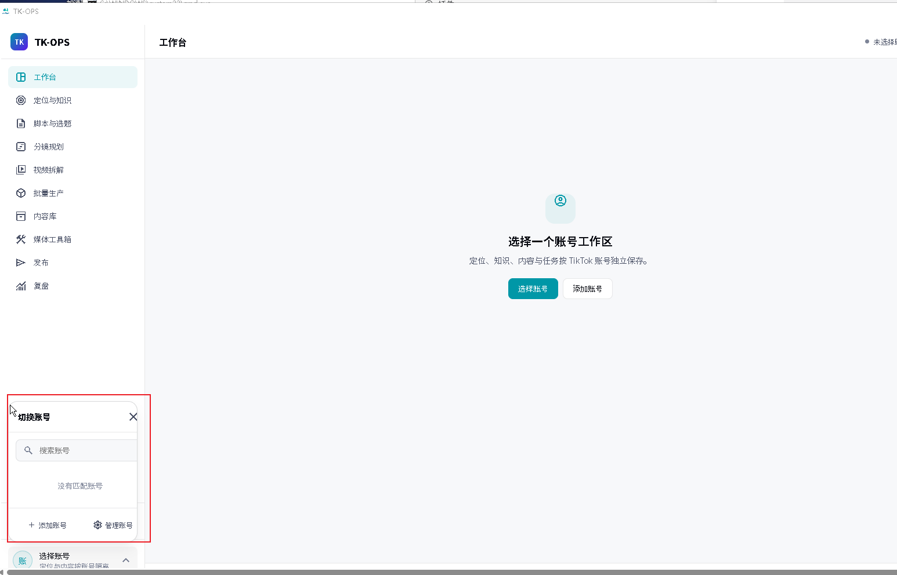
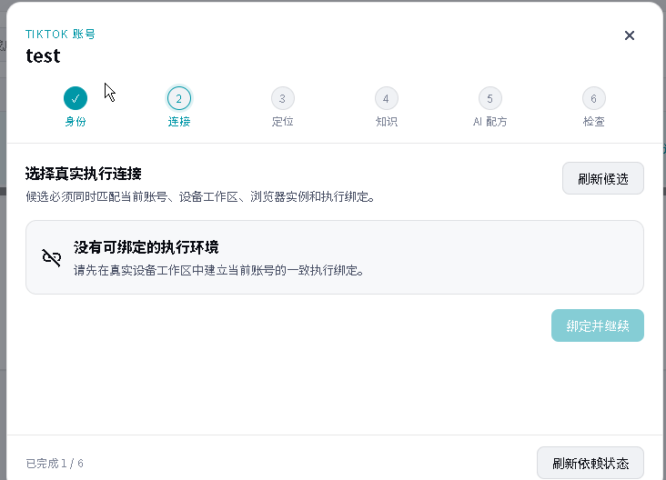

# 账号工作区与执行环境闭环审计

> 日期：2026-08-02  
> 范围：账号切换器、真实工作区目录、浏览器实例、执行环境绑定  
> 结论：当前链路存在阻断级缺口，不是用户操作问题

## 1. 审计结论

当前实现有三个相互关联的问题：

1. 账号切换器所在的工作区壳产生页面级横向滚动，底部触发器被滚动条覆盖；菜单宽度又被限制在侧栏内部，视觉上像只显示了半块。
2. AI 与系统设置中的 Runtime 分区只显示全局 Runtime 数据根诊断，不是可配置的账号 `DeviceWorkspace`；正式入口没有本地工作目录选择与注册能力。
3. 账号向导的“连接”步骤只能选择已有 `ExecutionBinding`，但正式 UI 没有创建 `DeviceWorkspace -> BrowserInstance -> ExecutionBinding` 的入口。新安装、新账号自然没有候选，因此会进入无法继续的死路。

## 2. 当前体验证据

### 2.1 账号切换器被裁切



主要根因：

- `account-workspace.css` 使用 `100vw / 100vh`，而 `shell.css` 的页面重置未被入口样式导入，造成视口横向溢出。
- 展开菜单被固定在约 224px 的侧栏宽度内；短窗口时还可能受侧栏层叠上下文限制。

这应修正为无页面级滚动条、菜单完整位于视口内，并在宽屏和紧凑 PC 窗口保持一致。

### 2.2 首次使用无法建立执行环境



当前页面只有“刷新候选”，没有“创建执行环境”。Runtime 候选查询又要求以下三个对象已存在、属于同一账号且引用一致：

```text
DeviceWorkspace
  -> BrowserInstance
  -> ExecutionBinding
```

旧设备接口创建的工作区和浏览器实例没有写入 `account_id`，旧绑定还存在字段错位，不能成为 v1 账号向导候选；旧设备管理页也已从正式路由移除。因此目前没有用户可完成的建立方式。

## 3. 概念边界

必须区分两类目录：

| 概念 | 用途 | 当前状态 | 目标状态 |
| --- | --- | --- | --- |
| Runtime 数据根 | 数据库、日志、缓存和 Sidecar 数据 | 只读诊断展示 | 继续由 Bootstrap / 配置总线受控管理 |
| 账号设备工作区目录 | 当前 TikTok 账号的浏览器 Profile、下载、临时媒体与执行证据 | 正式入口缺失 | 由原生目录选择器创建真实 `DeviceWorkspace` |

不能把 Runtime 数据根的展示地址当成账号工作目录，也不能让页面用一个任意文本路径代替真实工作区对象。

## 4. 目标用户流程

```text
账号向导“连接”
  -> 创建执行环境
  -> 选择本地工作目录
  -> Runtime 校验并注册目录引用
  -> 创建账号级 DeviceWorkspace
  -> 检测 Chrome / Edge
  -> 创建账号级 BrowserInstance 与 Profile
  -> 启动并健康检查
  -> 创建完整 ExecutionBinding
  -> 自动刷新并选中新候选
  -> 绑定并继续
```

账号详情和系统设置还应提供同一服务能力的管理入口，用于查看健康状态、重试、解除绑定和重新建立；业务规则只存在于 Runtime 服务层，向导与设置页不各自实现一套。

## 5. 关键实现偏差

- `WizardConnectionStep.vue` 只有刷新与选择，没有环境创建动作。
- v1 `account_connection` 只提供候选查询与绑定选择，不提供环境 provisioning。
- 候选查询强制工作区、浏览器实例、执行绑定三者同账号；这是正确约束，应保留。
- 旧工作区和浏览器创建没有持久化 `account_id`。
- 旧绑定实现把浏览器实例标识错误写入工作区字段，不能继续作为生产契约。
- 正式 `RuntimeWorkspace.vue` 是只读诊断面，旧 `DeviceWorkspaceManagementPage.vue` 已被路由重定向。
- 已批准 P0 规格把真实环境创建留到 P0-F，但 P0-F 实际只补齐 Sidecar / Supervisor，没有完成用户建立链路。

## 6. 审计健康度

| 区域 | 状态 | 严重度 |
| --- | --- | --- |
| 账号切换器布局 | 视口溢出、底部覆盖、菜单过窄 | 高 |
| 工作目录配置 | 正式入口缺失，概念混淆 | 阻断 |
| 执行环境创建 | 无生产闭环 | 阻断 |
| 账号绑定约束 | 同账号一致性约束正确，但缺 provisioning | 高 |
| 空态恢复路径 | 只有刷新，没有创建或修复动作 | 阻断 |

修正计划见 `docs/superpowers/plans/2026-08-02-account-workspace-execution-environment-closure.md`。
