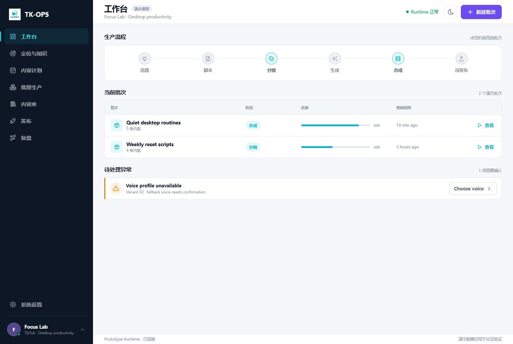
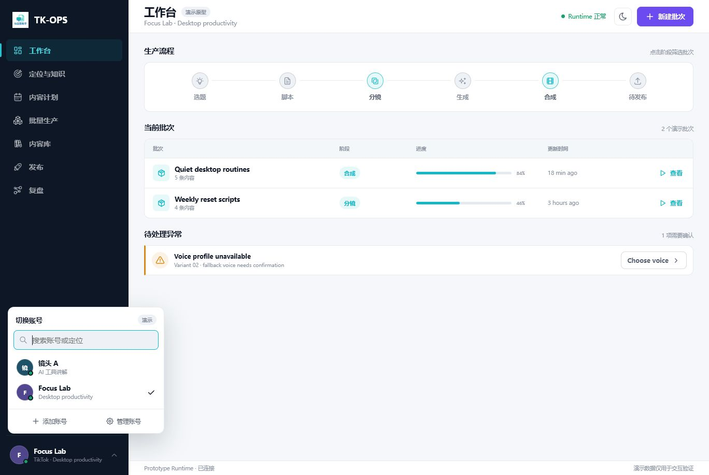
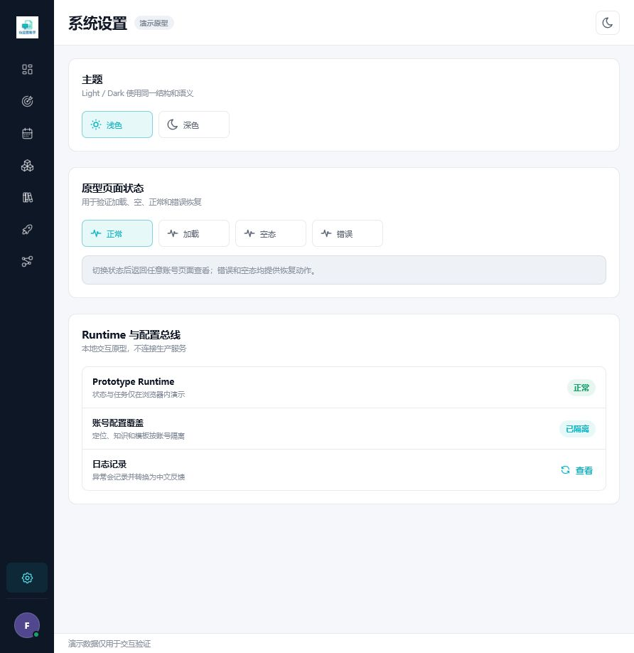
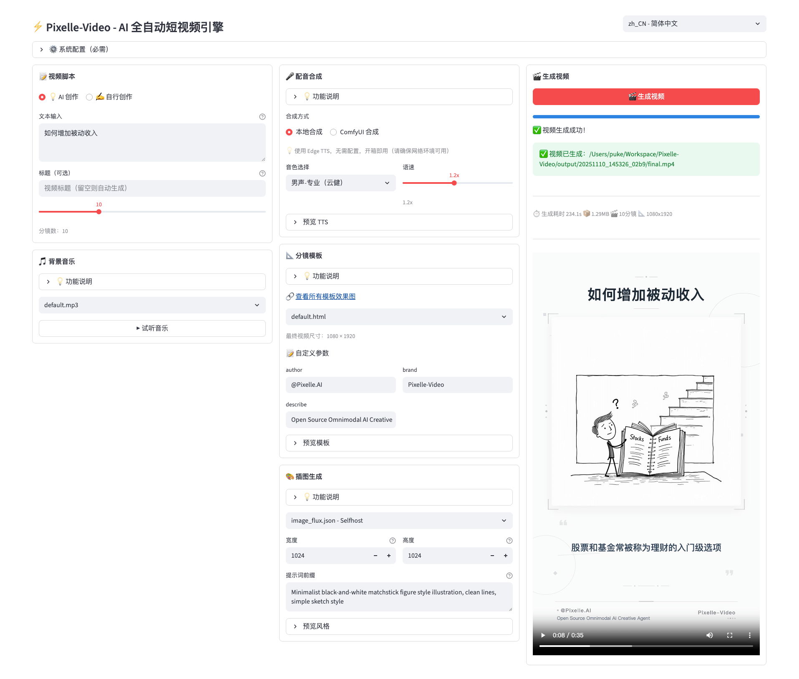

# TK-OPS 账号管理与 AI 创作能力原型审计

**日期：** 2026-07-19  
**范围：** 当前账号优先交互原型、账号切换入口、系统设置，以及 Pixelle-Video 的公开能力与界面参考  
**结论：** 当前信息架构方向成立，但账号生命周期和 AI 执行透明度仍是两个明显断点。

## 1. 证据与流程健康度

### 1.1 当前账号工作台：基本健康，AI 过程不可见

优点：

- 当前账号身份、生产阶段、批次和异常形成了低噪音主线。
- 页面没有退回统计大屏或复杂剪辑时间线。
- 账号切换后整个工作区变化的产品心智清晰。

问题：

- “脚本、分镜、生成、合成”只表达了阶段，没有说明当前使用哪个 AI 配方、模型、知识快照或降级策略。
- 用户无法判断 AI 正在做什么、为何失败、成本与耗时如何、能否只重试某一步。
- “新建批次”没有体现 AI 主题生成、固定脚本、已有素材等输入模式。

### 1.2 账号切换器：入口健康，管理动作断链

优点：

- 搜索、账号列表、添加账号和管理账号都放在左下角，符合系统级入口的频率。
- 账号没有被错误地添加为第八个高频主导航。

问题：

- 点击“管理账号”后页面没有变化，也没有加载、成功或失败反馈。
- “添加账号”没有账号创建、真实工作区绑定、知识库初始化和健康检查流程。
- 缺少账号状态、归档恢复、配置复制、绑定异常和数据边界说明。

### 1.3 系统设置：壳层健康，AI 能力中心缺失

现有内容只覆盖主题、原型状态模拟、Runtime、配置总线和日志提示。缺失：

- Provider 与凭据管理。
- 模型、能力、可用性和健康检查。
- 系统默认、账号 AI 配方、批次临时覆盖之间的继承关系。
- 超时、并发、成本上限、失败降级与重试策略。

## 2. Pixelle-Video 参考审计

公开资料显示，Pixelle-Video 已覆盖主题或固定脚本输入、脚本生成、图片与视频生成、TTS、BGM 和一键合成，并提供直接模型 API、ComfyUI、RunningHub、历史记录与批任务能力：

- 项目与 README：<https://github.com/ATH-MaaS/Pixelle-Video>
- 官方文档：<https://aidc-ai.github.io/Pixelle-Video/zh/>
- 流水线实现：<https://github.com/ATH-MaaS/Pixelle-Video/tree/main/pixelle_video/pipelines>
- 模型能力适配：<https://github.com/ATH-MaaS/Pixelle-Video/blob/main/pixelle_video/services/api_media.py>

值得吸收：

- 把生成拆成可编排的原子能力与流水线，而不是一个不可解释的“AI 生成”按钮。
- 同时支持主题生成、固定脚本、已有资产和图生视频等输入模式。
- 用能力声明驱动可选参数，依据模型真实支持的时长、比例、分辨率和生成模式显示 UI。
- 支持直接 Provider 与可选工作流适配器，并记录历史与批任务。

不应照搬：

- 不把脚本、语音、图片、视频和模板的全部参数同时铺在一个三栏页面。
- 不让账号级创作偏好与系统级密钥混在一起。
- 不让用户为了开始生产先理解所有模型参数。

TK-OPS 应采用“快捷配方 + 渐进展开高级设置 + 任务节点详情”的低噪音表达。

## 3. 优先问题

| 优先级 | 问题 | 影响 | 建议 |
| --- | --- | --- | --- |
| P0 | 管理账号按钮无响应 | 核心入口不可完成 | 建立系统级账号管理页与创建向导 |
| P0 | 批次中 AI 能力不可见 | 生成不可解释、不可恢复 | 展示 AI 配方、知识快照与执行节点 |
| P0 | 系统设置没有 Provider 能力中心 | 无法配置真实 AI 链路 | 建立凭据、能力、健康和默认策略管理 |
| P1 | 账号没有独立 AI 创作档案 | 不同定位无法稳定生产 | 按账号保存可继承的 AI Recipe |
| P1 | 新建批次没有输入模式 | 无法覆盖真实生产场景 | 增加主题、固定脚本、已有素材入口 |
| P1 | 失败只能按整批理解 | 成本高且恢复粗糙 | 支持节点级重试、降级和局部重生成 |
| P2 | 高级参数可能再次制造噪音 | 破坏当前低噪音方向 | 默认使用预设，高级设置放入抽屉 |

## 4. 审计边界

- 本次只审计本地交互原型和公开项目资料，没有验证真实 TikTok 登录、发布、Provider 调用或 Runtime 数据契约。
- 截图能证明可见结构与点击结果，不能单独证明键盘可访问性或 WCAG 合规。
- 后续原型中的账号、Provider 和生成结果仍应明确标注为演示状态，不能伪装成真实绑定或真实生成。
