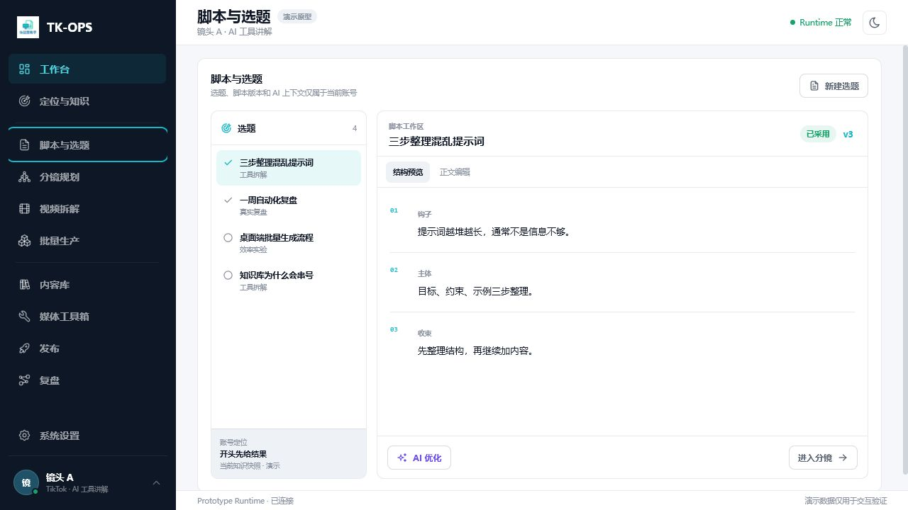
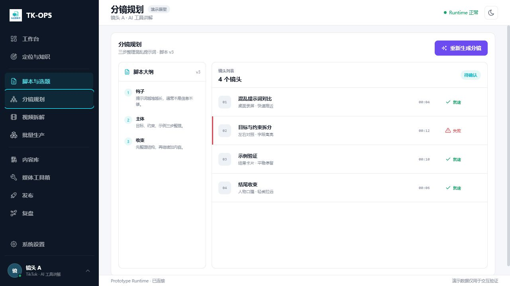
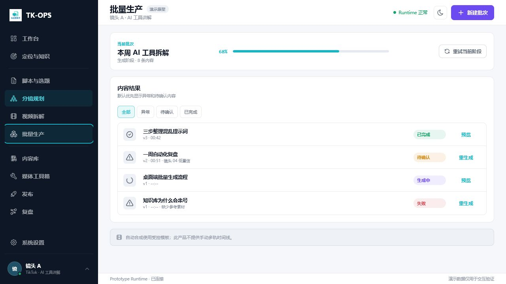
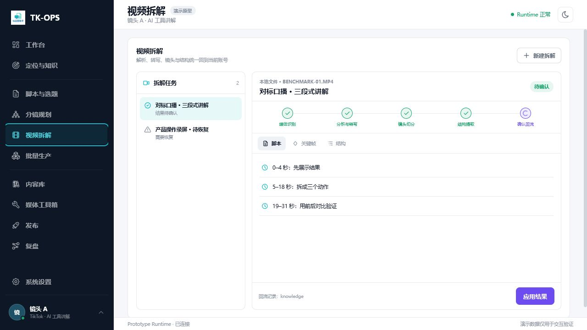
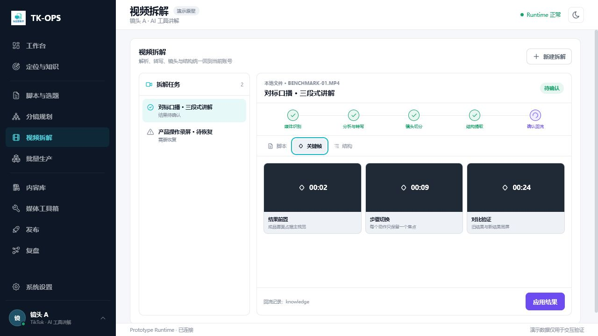
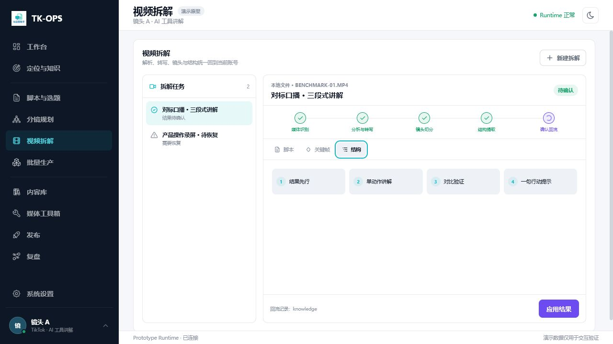
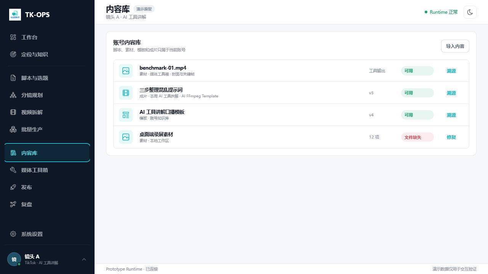

# TK-OPS 创作主链交互审计

> 日期：2026-07-19  
> 对象：`docs/prototypes/tk-ops-account-workspace` 交互原型  
> 结论：当前页面入口齐全，但缺少同一个 `ContentItem` 在选题、脚本、分镜、生产与资产之间的对象级接力。

## 1. 核心判断

产品真源已经定义：

```text
ContentPlan
└── ContentItem
    ├── Topic / Brief
    ├── ScriptVersion
    ├── StoryboardVersion
    └── SourceReference

ProductionBatch
└── ContentVariant
    └── immutable ContentItem / ScriptVersion / StoryboardVersion references
```

当前原型没有把这套关系呈现出来：选题在 `accounts.js`，脚本和分镜在 `creativeWorkflow.js`，批量生产直接读取 `variants`，内容库又读取另一组 `library`。它们通过相同标题制造了“像是同一条内容”的视觉印象，却没有真正的主对象、版本引用、生产接力和资产归档关系。

## 2. 五项问题核验

| 用户问题 | 审计发现 | 严重度 | 修正方向 |
| --- | --- | --- | --- |
| 脚本、分镜、拆解和批量生产关系不清 | 页面之间只有导航跳转；批次条目不展示来源选题、采用脚本或确认分镜 | 阻断 | 以 `ContentItem` 贯穿，批次只消费已确认版本 |
| 不知道如何新建选题 | 页面右上角虽有“新建选题”，但视觉层级低，点击后只有 Toast，没有创建表单、数据写入和后续动作 | 阻断 | 提升为主动作，并提供低噪音创建向导 |
| 分镜之后没有下一步 | 分镜页主动作始终是生成或重新生成；没有“确认分镜”“生成单条”“加入批次” | 阻断 | 增加确认与生产交接弹层，单条生产本质上创建单项批次 |
| 拆解结果演示不足 | 脚本只有三行摘要；关键帧是占位色块；结构只有标签；缺少关键词、证据时间点和回流影响预览 | 高 | 拆成脚本、关键词、关键帧、结构四种可验证结果，并显示回流预览 |
| 内容库分类不足 | 当前为无筛选的四行列表，视频、图片、音频、文档、模板与工具输出没有统一分类层 | 高 | 复用项目资产中心的类型筛选、搜索、卡片墙和详情溯源模式 |

## 3. 当前页面证据

### 3.1 脚本与选题



- 页面能看到“新建选题”，但它是次级按钮，且未形成真实创建流程。
- 左侧选择的是 Topic，右侧直接展示 Script；用户看不到二者属于哪个 `ContentItem`，也看不到当前内容在完整链路中的位置。

### 3.2 分镜规划



- 分镜已存在时仍只有“重新生成分镜”。
- 页面没有确认状态、生产去向和下一步主动作，因此链路在这里终止。

### 3.3 批量生产



- 批次条目只展示标题、版本、时长和最终状态。
- 看不到选题、脚本、分镜是否完备，也不能回到对应创作对象。
- 单条创作链和批量生产链是两套孤立交互。

### 3.4 视频拆解







- 脚本结果没有逐段正文、可选区块和来源证据。
- 当前没有关键词结果。
- 关键帧只有占位卡，没有画面摘要、视觉元素和可回流字段。
- 结构是四个平铺标签，没有时长占比、结构作用和证据时间段。

### 3.5 内容库



- 类型通过每行副文案隐含表达，没有“全部 / 视频 / 图片 / 音频 / 文档”主分类。
- 工具输出、成片、脚本、模板、拆解来源混在同一维度，无法快速定位可用资产。

## 4. 目标关系

```text
手动新建 / AI 推荐 / 视频拆解
              ↓
          ContentItem
              ↓
      选题 → 脚本 → 分镜
                    ↓
      生成单条 ─────┼───── 加入批次
                    ↓
             ProductionBatch
                    ↓
             ContentVariant
                    ↓
       视频 / 图片 / 音频 / 文档资产
                    ↓
                 内容库
```

视频拆解不是每条视频都必须经过的生产步骤，而是选题、脚本、分镜和知识的上游来源。批量生产不是另一个创作入口，而是消费一个或多个已准备 `ContentItem` 的执行编排层。
