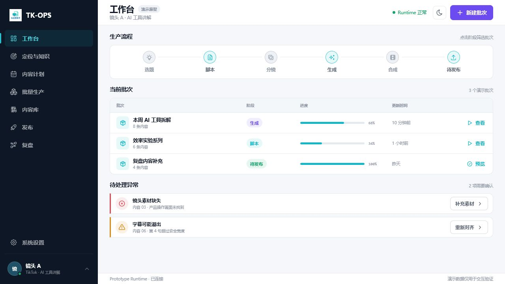
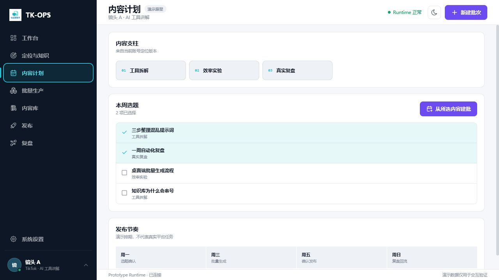
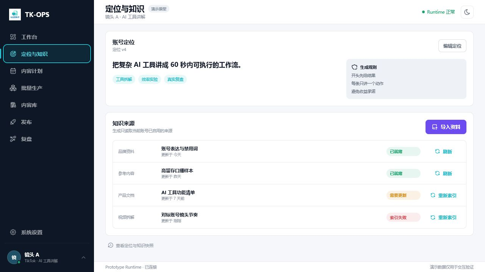

# 创作前链路与媒体工具可发现性审计

**日期：** 2026-07-19  
**对象：** `docs/prototypes/tk-ops-account-workspace/`  
**用户目标：** 在当前账号工作区内完成选题、脚本、分镜、视频拆解、批量生产和常用媒体处理，而不是只看到批次阶段名称。

## 1. 审计结论

当前账号优先和低噪音方向正确，但信息架构收敛过度。脚本、分镜和视频拆解仍存在于数据或流程概念中，却缺少可进入、可编辑、可恢复的显式工作面；媒体工具箱则尚未进入当前产品真源与原型。

## 2. 步骤与证据

### 步骤 1：从工作台寻找创作前功能

**健康度：需改进。** 侧栏只有“内容计划”和“批量生产”，脚本与选题、分镜规划、视频拆解均不可直接发现。工作台阶段条显示“脚本”和“分镜”，但只能筛选批次，不能进入对应工作面。

### 步骤 2：进入内容计划

**健康度：部分可用。** 选题选择和建批动作清晰，但页面没有脚本策划字段、正文编辑、版本轨迹、AI 改写、确认采用或进入分镜的路径，因此不能替代“脚本与选题中心”。

### 步骤 3：寻找视频拆解

**健康度：不可完成。** “视频拆解”只作为知识来源类型出现，用户无法导入视频、查看解析阶段、浏览脚本文案 / 关键帧 / 内容结构，也不能把拆解结果回流脚本和分镜。

## 3. 已确认的仓库能力

- 生产前端已有 `ScriptTopicCenterPage.vue`，覆盖策划字段、AI 生成 / 改写、正文工作面、版本轨迹和 AI 作业。
- 生产前端已有 `StoryboardPlanningCenterPage.vue`，覆盖脚本结构对照、AI 生成分镜、镜头工作面、版本保存和脚本更新同步。
- 生产前端与 Runtime 已有视频拆解页面、导入、FFprobe、视频解析 / 转录、分段、结构提取、结果回写脚本和分镜的真实边界。
- 仓库已有 FFmpeg / FFprobe、资产与任务基础，但没有 `yt-dlp`、链接下载或去水印实现；媒体工具必须作为新增能力规划，不能在原型里伪装已经可用。

## 4. 结构性建议

1. 恢复三个显式账号级入口：脚本与选题、分镜规划、视频拆解。
2. 保留“砍掉 AI 剪辑工作台”的决定；分镜之后直接进入批量生产和自动合成。
3. 增加账号级“媒体工具箱”，工具输出自动进入当前账号内容库，不为每个工具增加独立页面。
4. 侧栏采用分组与分隔线控制密度，紧凑窗口继续使用图标侧栏和可访问名称。
5. 媒体任务统一显示排队、处理中、正在取消、失败、完成，并提供取消、重试、打开输出和导入内容库。

## 5. 可访问性风险与证据边界

- 新增入口后需要重新验证紧凑窗口的键盘焦点顺序、图标可访问名称和侧栏滚动边界。
- 工具向导必须提供明确标签、错误文本和长任务状态播报，不能只依赖颜色。
- 本次截图可确认可发现性和页面结构，不能单独证明键盘操作、屏幕阅读器或完整 WCAG 合规。

