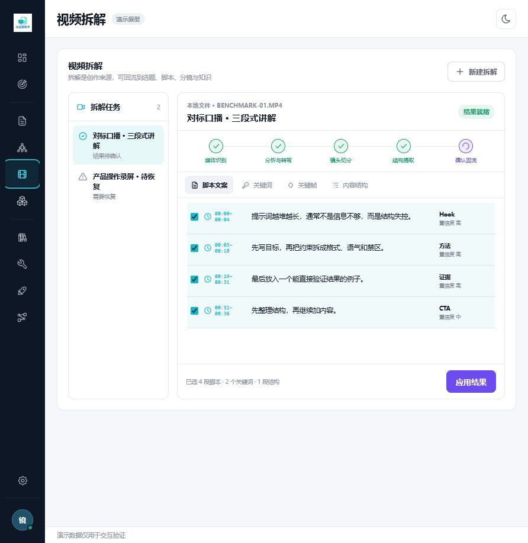
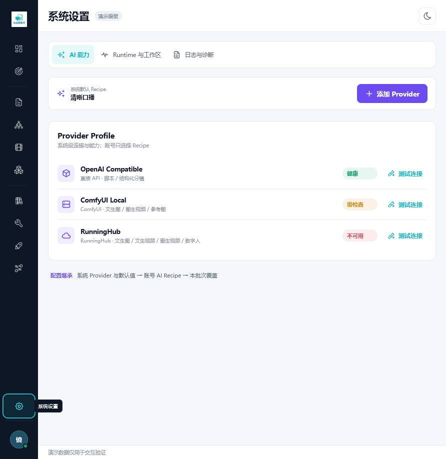
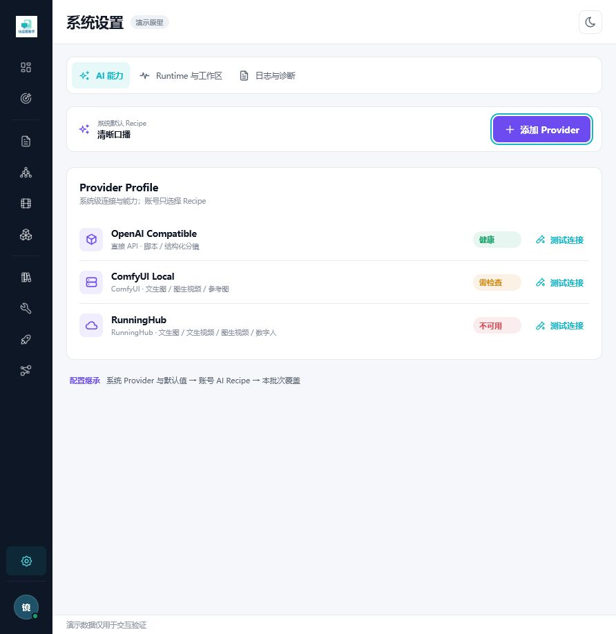
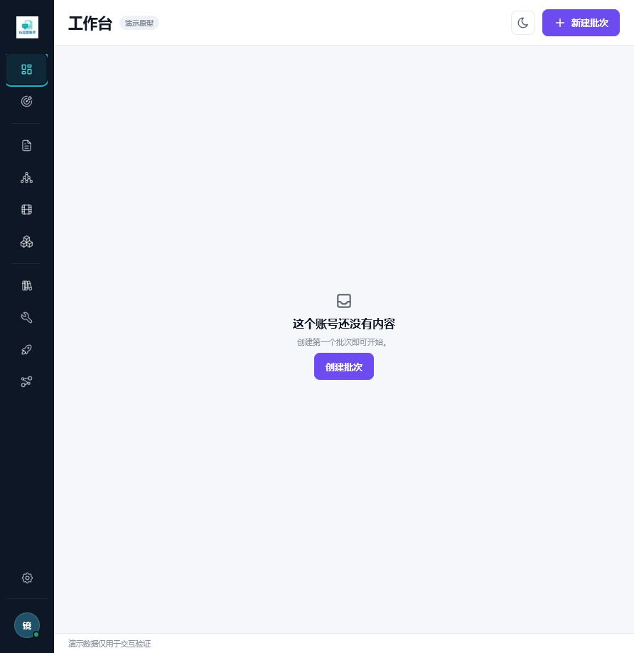
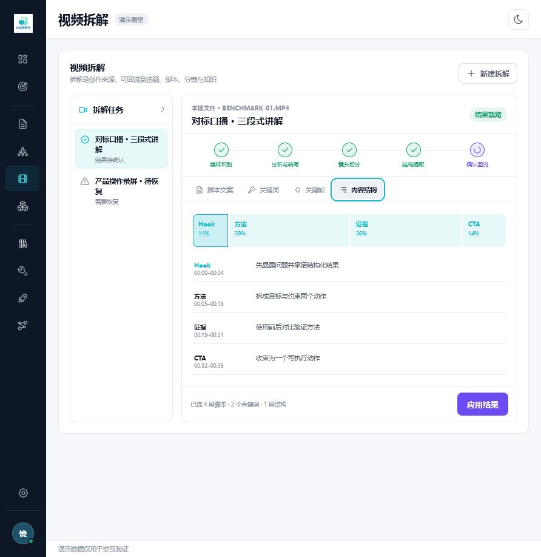

# TK-OPS 拆解表格、AI 设置与空状态增量审计

> 日期：2026-07-19  
> 范围：视频拆解结果、系统 AI 能力设置、账号无数据状态  
> 证据：本次审计从本地交互原型 `http://127.0.0.1:4173/` 重新捕获，未复用旧截图

## 1. 审计目标

验证以下三项反馈是否成立，并识别同级结构性遗漏：

1. 视频拆解四类结果是否足够清晰、易读、可选择和可回流。
2. 系统设置是否能完成 Provider、调用模型、能力路由与 Prompt 的配置闭环。
3. 无业务数据时，各页面是否提供符合当前前置条件的下一步，而不是只显示演示数据或统一占位。

## 2. 审计步骤与健康度

### Step 1：查看脚本文案结果 — 需改进

- 优点：四个结果入口收敛在同一区域；时间码、段落作用、置信度和选择状态均可见。
- 问题：当前使用整行淡青底的自定义卡片列表，列关系不稳定；时间、正文、作用和置信度无法快速纵向比较。
- 建议：改为真实语义表格，固定列为选择、时间段、脚本文案、段落作用、置信度；正文列获得最大宽度，选择态只使用局部背景和勾选框。

### Step 2：查看 AI 能力设置 — 需改进

- 优点：Provider 连接、健康状态和账号 Recipe 的继承方向已经明确。
- 问题：页面只有 Provider 列表；模型虽然存在于 Provider 详情数据中，但无法新增、编辑、启停或绑定到具体 AI 功能，也没有 Prompt 配置入口。
- 建议：AI 能力区增加“Provider / 模型与能力 / Prompt 模板”三个二级分区，不增加主导航。

### Step 3：点击添加 Provider — 不可用

- 已确认点击前后对话框数量均为 `0`，没有新增表单或成功 / 失败反馈。
- 这是可见死按钮，应列为 P0；按钮应打开真实可完成的 Provider 向导，并覆盖校验、测试、保存、失败和重试。

### Step 4：查看账号空态 — 需重构

- 优点：空态低噪音，标题、说明和单一主动作符合视觉规范。
- 问题：一个全局 `pageState=empty` 覆盖所有业务页；“没有内容”直接引导“创建批次”，跳过定位、AI 能力、选题、脚本和分镜前置条件。
- 建议：保留加载与错误的全局状态，但把业务空态改为按页面数据和依赖推导；区分首次空、筛选为空、依赖未满足、能力不可用和等待外部结果。

### Step 5：查看内容结构 — 需补充总结

- 优点：比例条能快速表达 Hook、方法、证据和 CTA 的时长分布。
- 问题：结构段仍是无表头列表；缺少对整条视频的特点总结、节奏判断、叙事手法和可复用 Tag。
- 建议：比例条作为表格上方摘要保留；新增一至两句视频特点总结和可选择 Tag，再用表格展示结构段、时间、占比、作用、对应文案和证据关键词。

## 3. 最高优先级问题

1. **P0 · AI 配置闭环缺失**：Provider、模型、能力、Prompt 和账号 Recipe 没有形成可配置、可验证的调用链。
2. **P0 · 空态主动作可能错误**：当前统一“创建批次”会把首次用户送入尚未满足前置条件的下游步骤。
3. **P1 · 拆解结果比较效率低**：四类结果使用不同卡片或条目结构，难以快速纵向比较、批量选择和识别证据。
4. **P1 · AI 就绪状态未回传业务页**：系统能力缺失时，脚本、分镜、拆解和生产入口仍可能显示可执行，缺少“缺哪个模型 / Prompt、去哪里修复”的阻断说明。
5. **P2 · 设置页中英文层级不统一**：`Provider Profile`、`Recipe` 等术语可以保留，但页面标题和说明应优先使用中文，并把英文作为技术名词而不是主要信息层级。

## 4. 空状态应覆盖的场景

| 场景 | 判断依据 | 主动作 |
| --- | --- | --- |
| 首次账号 | 定位、知识、AI Recipe 或连接未就绪 | 完成账号设置 |
| 创作为空 | 无 `ContentItem` | 新建选题 |
| 分镜前置不足 | 无已采用脚本 | 返回脚本并采用 |
| 生产前置不足 | 无已确认分镜 | 继续创作 |
| 拆解为空 | 无拆解任务 | 导入视频 |
| 内容库为空 | 当前账号无资产 | 导入素材或从生产归档 |
| 筛选为空 | 有数据但筛选结果为零 | 清除筛选 |
| 发布为空 | 无可发布成片 | 前往生产 |
| 复盘为空 | 无真实平台回执 | 等待回执或检查连接 |
| AI 能力受限 | 能力路由、模型或 Prompt 缺失 | 前往 AI 能力修复 |

## 5. 可访问性风险与证据限制

- 当前标签页、复选框和按钮具备基本语义，点击 Provider 后焦点环可见。
- 部分辅助文字和时间码字号较小；改为表格后需要保证表头、行选择名称、键盘顺序和局部滚动区域可被识别。
- 本次确认了 DOM 语义、可见焦点和主要点击结果，但没有使用屏幕阅读器，也不能仅凭截图宣称完整 WCAG 合规。

## 6. 结论

现有原型的产品方向正确，问题集中在“数据结果的专业呈现”和“系统能力配置的真实闭环”，不是需要推翻视觉框架。推荐保留当前低噪音壳层和四标签结构，重做结果容器、AI 配置二级结构以及数据驱动空态。

